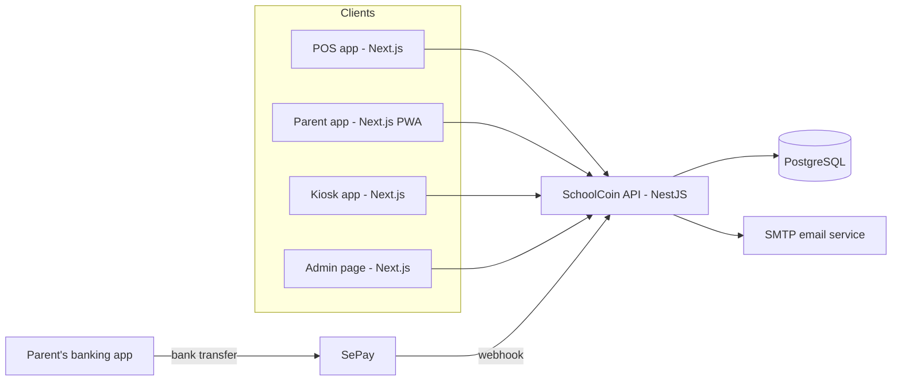
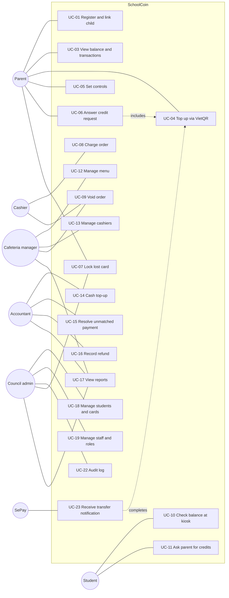
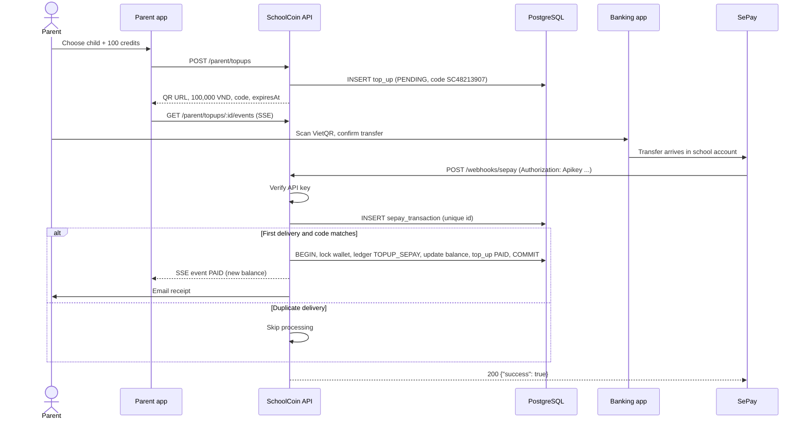
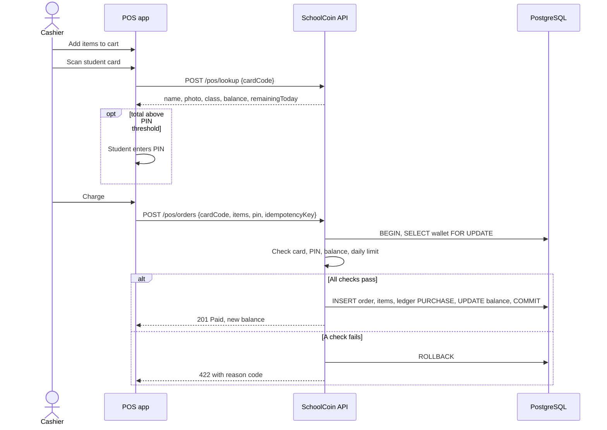
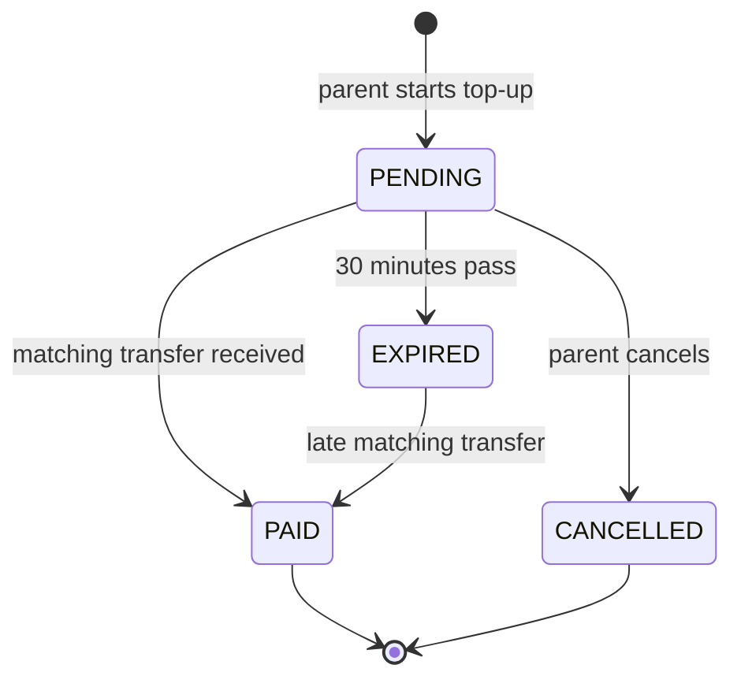
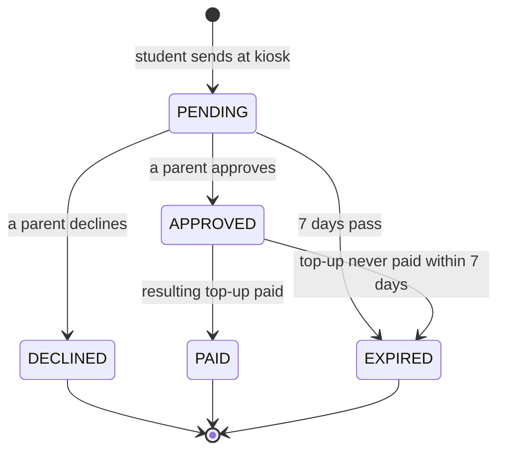
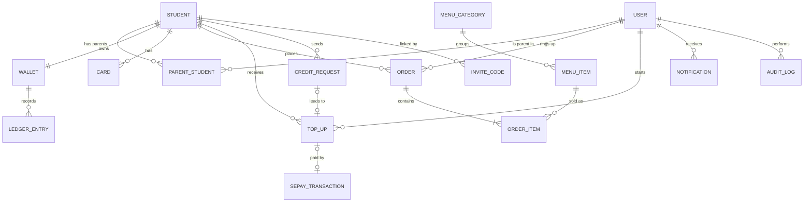

# SchoolCoin — Software Requirements Specification and Technical Design

Nov 19, 2026 · @Tri Quang Bi

SchoolCoin is a prepaid credit system for one school: parents top up by VietQR bank transfer through SePay, students pay at the cafeteria with a student card, a kiosk lets students check their balance and ask for more, and the school council runs it all from an admin page. 1 credit = 1,000 VND.

|                                 |                                                                                                                       |
| ------------------------------- | --------------------------------------------------------------------------------------------------------------------- |
| Course                          | Software Engineering                                                                                                  |
| Version                         | 1.0 — draft for team review                                                                                           |
| Team (6: 4 backend, 2 frontend) | Le Duc Anh (202417097) · \[Member 2, ID\] · \[Member 3, ID\] · \[Member 4, ID\] · \[Member 5, ID\] · \[Member 6, ID\] |
| Stack                           | Next.js (4 front-end apps) · NestJS (API) · PostgreSQL · SePay                                                        |

**Part A** is the Software Requirements Specification for grading, structured after ISO/IEC/IEEE 29148. **Part B** is the technical appendix the team builds from: architecture, data model, API, SePay integration, task split and milestones.

# Part A — Software Requirements Specification

## 1. Introduction

### 1.1 Purpose

This SRS defines what SchoolCoin must do and the qualities it must have. SchoolCoin is a closed-loop school credit system: parents put money into a prepaid wallet for their child by bank transfer, students spend the credits at the school cafeteria by scanning a student card, students check their balance and ask their parents for more at a self-service kiosk, and the school council manages everything through an admin page.

### 1.2 Scope

SchoolCoin consists of four web applications and one backend service:

| App                           | Users                                        | Purpose                                                                                                           |
| ----------------------------- | -------------------------------------------- | ----------------------------------------------------------------------------------------------------------------- |
| POS (cafeteria point of sale) | Cashiers                                     | Ring up orders and charge them to a student's wallet by scanning the student card                                 |
| Parent app                    | Parents                                      | Top up a child's wallet by VietQR bank transfer (via SePay), track spending, set controls, answer credit requests |
| Kiosk                         | Students                                     | Check balance and recent purchases, ask a parent for more credits                                                 |
| Admin page                    | Council admin, accountant, cafeteria manager | Manage people, cards, menu, money, reports and audit                                                              |
| API (backend)                 | All apps, SePay                              | Business logic, wallet ledger, payment webhook, notifications                                                     |

**In scope:** everything in the table above, the SePay bank-transfer integration (run in SePay Test mode for the course), email notifications, and printable student cards.

**Out of scope:** native mobile apps; card or e-wallet payments other than bank transfer; cafeteria stock and inventory; vendor settlement (the school runs the cafeteria itself, so all money stays with the school); paying out balances automatically (refunds are recorded in the system, but the cash or bank transfer happens outside it); student accounts or logins other than card plus PIN at the kiosk.

### 1.3 Definitions

| Term                  | Meaning                                                                                                                                                           |
| --------------------- | ----------------------------------------------------------------------------------------------------------------------------------------------------------------- |
| Credit                | The unit of value. **1 credit = 1,000 VND.** Balances and prices are whole credits.                                                                               |
| Wallet                | The credit balance of one student. Each student has exactly one wallet.                                                                                           |
| Ledger entry          | An append-only record of one change to a wallet (top-up, purchase, reversal, refund, adjustment). A wallet's balance always equals the sum of its ledger entries. |
| Top-up                | Adding credits to a wallet, by bank transfer (SePay) or by cash at the school office.                                                                             |
| Payment code          | A unique code such as SC48213907 that the system puts in the transfer content so it can match an incoming transfer to a top-up.                                   |
| Unmatched payment     | An incoming transfer the system could not match to a top-up (missing or wrong code). It waits for an accountant.                                                  |
| Daily limit           | The most credits a student may spend in one calendar day (Vietnam time), set by a parent.                                                                         |
| Low-balance threshold | The balance below which a parent wants an alert.                                                                                                                  |
| Credit request        | A student's request, made at the kiosk, for a parent to add credits.                                                                                              |
| Student card          | A physical card printed with a QR code or barcode that encodes the card code.                                                                                     |
| Card code             | A random, opaque string on the card, unrelated to the student ID so it cannot be guessed.                                                                         |
| PIN                   | A 4-digit number the student chooses; required at the kiosk and for POS orders above the PIN threshold.                                                           |
| SePay                 | A Vietnamese service that watches a bank account and calls a webhook on our server when a transfer arrives.                                                       |
| VietQR                | The national QR standard for bank transfers; any Vietnamese banking app can scan it.                                                                              |

### 1.4 References

- ISO/IEC/IEEE 29148:2018, Systems and software engineering — Life cycle processes — Requirements engineering
- [SePay developer documentation](https://developer.sepay.vn): webhooks, VietQR generation, Test mode
- Next.js and NestJS official documentation

## 2. Overall description

### 2.1 Product perspective

SchoolCoin is a new, self-contained system. The four front-end apps talk only to the SchoolCoin API over HTTPS. The API owns the PostgreSQL database and is the only component that changes money. Two external systems are involved: **SePay**, which notifies the API of incoming bank transfers, and an **SMTP email service**, which delivers notifications.



### 2.2 Users and actors

| Actor                | Description                                                                                       | How they sign in                    |
| -------------------- | ------------------------------------------------------------------------------------------------- | ----------------------------------- |
| Parent               | Parent or guardian of one or more students. A student can be linked to up to two parent accounts. | Email + password                    |
| Student              | Has no account. Interacts only by scanning their card (POS, kiosk) and entering their PIN.        | Card + PIN (kiosk only)             |
| Cashier              | Cafeteria staff operating the POS.                                                                | Username + password on the POS      |
| Cafeteria manager    | Manages the menu, prices, cashier accounts and sales reports.                                     | Email + password                    |
| Accountant           | Handles cash top-ups, unmatched payments, refunds and financial reports.                          | Email + password                    |
| Council admin        | Full control: users, students, cards, families, settings, audit log.                              | Email + password                    |
| SePay (external)     | Sends a webhook for each incoming bank transfer.                                                  | API key in the Authorization header |
| Scheduler (internal) | Runs timed jobs: expires old top-ups and requests.                                                | —                                   |

### 2.3 Operating environment

- **POS:** a laptop or touchscreen PC at the counter running Chrome, with a USB barcode/QR scanner (which acts as a keyboard) or the laptop's webcam.
- **Kiosk:** a touchscreen PC or tablet in fullscreen kiosk mode, with a USB scanner or webcam.
- **Parent app:** any modern mobile or desktop browser; installable as a PWA.
- **Admin page:** desktop browser, 1280 px wide or more.
- **Server:** Node.js 22 LTS and PostgreSQL 16, run with Docker.

### 2.4 Design and implementation constraints

- **C-01** All four front-ends use Next.js (App Router, TypeScript); the backend uses NestJS (TypeScript).
- **C-02** Bank-transfer top-ups use SePay. Development and the course demo use SePay Test mode with simulated transfers.
- **C-03** 1 credit = 1,000 VND, and credits are whole numbers.
- **C-04** Students have no accounts; student personal data is limited to what the system needs.
- **C-05** Team of six: four backend and two frontend developers.
- **C-06** The SePay webhook must reach the API over the public internet (a tunnel such as ngrok is acceptable for the demo).

### 2.5 Assumptions and dependencies

- **A-01** The school has a bank account that can be linked to SePay (for the demo, a SePay Test mode account).
- **A-02** The school prints student cards from the printable layout the admin page produces.
- **A-03** Parents have a Vietnamese banking app that can scan VietQR.
- **A-04** The school runs the cafeteria itself; no vendor settlement is needed.

## 3. Use cases

### 3.1 Use case list

| ID    | Use case                                      | Primary actor                                |
| ----- | --------------------------------------------- | -------------------------------------------- |
| UC-01 | Register and link a child with an invite code | Parent                                       |
| UC-02 | Sign in, sign out, reset password             | Parent, staff                                |
| UC-03 | View a child's balance and transactions       | Parent                                       |
| UC-04 | Top up via VietQR (SePay)                     | Parent                                       |
| UC-05 | Set daily limit and low-balance threshold     | Parent                                       |
| UC-06 | Answer a credit request                       | Parent                                       |
| UC-07 | Lock a lost card                              | Parent, council admin                        |
| UC-08 | Charge an order at the POS                    | Cashier                                      |
| UC-09 | Void an order                                 | Cashier, cafeteria manager                   |
| UC-10 | Check balance at the kiosk                    | Student                                      |
| UC-11 | Ask a parent for credits                      | Student                                      |
| UC-12 | Manage the menu and prices                    | Cafeteria manager                            |
| UC-13 | Manage cashier accounts                       | Cafeteria manager                            |
| UC-14 | Record a cash top-up                          | Accountant                                   |
| UC-15 | Resolve an unmatched payment                  | Accountant                                   |
| UC-16 | Record a refund                               | Accountant                                   |
| UC-17 | View reports                                  | Accountant, cafeteria manager, council admin |
| UC-18 | Manage students, cards and PINs               | Council admin                                |
| UC-19 | Manage staff users and roles                  | Council admin                                |
| UC-20 | Create family invite codes                    | Council admin                                |
| UC-21 | Change system settings                        | Council admin                                |
| UC-22 | View the audit log                            | Council admin                                |
| UC-23 | Receive a bank transfer notification          | SePay (system)                               |
| UC-24 | Expire stale top-ups and requests             | Scheduler (system)                           |

### 3.2 Use case diagram



The council admin can do everything the accountant and cafeteria manager can; those links are left out of the diagram for readability.

### 3.3 Detailed use cases

#### UC-04 Top up via VietQR (SePay)

- **Primary actor:** Parent. **Supporting actor:** SePay.
- **Preconditions:** the parent is signed in and linked to the student; the student's wallet is active.
- **Trigger:** the parent taps "Top up" on a child's page, or approves a credit request (UC-06).
- **Main flow:**
  1. The parent chooses a child and an amount in credits (presets 50 / 100 / 200 / 500, or a custom amount within the allowed range).
  2. The system creates a pending top-up with a unique payment code and shows the VietQR image, bank, account number, account holder, amount in VND, the payment code as transfer content, and a 30-minute countdown.
  3. The parent scans the QR with their banking app and confirms the transfer.
  4. SePay detects the transfer and calls the webhook (UC-23).
  5. The system matches the payment code, credits the wallet and marks the top-up paid.
  6. The parent's screen changes to "Success — 100 credits added" within 5 seconds of the webhook, without reloading, and the parent receives an email receipt.
- **Alternative flows:**
  - 3a. The parent leaves the page: the top-up stays pending and can be reopened from "Recent top-ups".
  - 5a. The amount transferred differs from the amount requested: the system credits ⌊amount / 1,000⌋ credits, records any remainder under 1,000 VND, and flags it for the accountant (BR-06).
  - 5b. The payment arrives after the 30 minutes: it is still credited, because the money has arrived (BR-08).
  - 5c. The transfer has no recognisable payment code: it becomes an unmatched payment (UC-15).
- **Postconditions:** the balance has increased, one TOPUP\_SEPAY ledger entry exists, and the top-up is paid.

#### UC-08 Charge an order at the POS

- **Primary actor:** Cashier.
- **Preconditions:** the cashier is signed in on the POS; the menu is loaded.
- **Main flow:**
  1. The cashier taps menu items; the cart shows quantities and the total in credits.
  2. The student's card is scanned.
  3. The POS shows the student's photo, name, class, balance and how much they may still spend today. The cashier checks the photo matches the student.
  4. If the total is above the PIN threshold (default 50 credits), the student enters their PIN on the POS screen.
  5. The cashier taps "Charge".
  6. In one database transaction the system checks the card is active, the PIN if needed, the balance and the daily limit; creates the order; writes a PURCHASE ledger entry; and updates the balance.
  7. The POS shows "Paid" with the new balance and clears the cart.
- **Alternative flows:**
  - 3a. The card is locked or unknown: "Card not valid — please see the office"; nothing is charged.
  - 4a. Wrong PIN: the POS shows the attempts left. After 5 wrong attempts the PIN locks for 15 minutes (BR-11).
  - 6a. Insufficient balance or daily limit reached: declined with the reason ("Not enough credits: balance 12, total 25" or "Daily limit reached: 8 credits left today"); nothing is charged.
  - 6b. The network fails after "Charge": the POS retries with the same idempotency key, so the student is never charged twice (NFR-REL-02).
- **Postconditions:** the balance has decreased by the order total; one order with its items and one ledger entry exist. If the purchase takes the balance below the parent's threshold, a low-balance alert is sent (FR-NOT-02).

#### UC-11 Ask a parent for credits

- **Primary actor:** Student. **Precondition:** signed in at the kiosk with card and PIN.
- **Main flow:**
  1. The student taps "Ask my parent for credits".
  2. The student picks an amount (20 / 50 / 100 / 200 credits) and may add a note of up to 100 characters.
  3. The system creates a pending credit request and notifies every linked parent in the app and by email.
  4. The kiosk confirms "Request sent".
- **Alternative flows:**
  - 2a. The student already sent 3 requests today: the button is disabled with "You can send up to 3 requests a day" (BR-09).
  - 3a. No parent is linked: "No parent account is linked — please see the office".
- **Postconditions:** a pending request exists; it ends approved then paid, declined, or expired after 7 days.

#### UC-06 Answer a credit request

- **Main flow:** the parent opens the request from the notification, sees the amount, note and current balance, and taps **Approve**. The request becomes approved and UC-04 starts with that amount, which the parent may change. When the top-up is paid, the request becomes paid.
- **Alternative flow:** the parent taps **Decline**, optionally with a reason. The student sees the outcome at the kiosk on their next sign-in. Once one parent answers, the other parent sees the request as closed.

#### UC-15 Resolve an unmatched payment

- **Primary actor:** Accountant. **Precondition:** a transfer arrived without a matching payment code.
- **Main flow:** the accountant opens "Unmatched payments", sees bank, time, amount, sender description and transfer content, finds the student by name or student code, and taps **Assign**. The wallet is credited with a TOPUP\_SEPAY entry, the payment is marked resolved, and the resolver is recorded.
- **Alternative flow:** the payment isn't for SchoolCoin (e.g. another school fee): the accountant marks it **Ignore** with a reason.
- **Postconditions:** the payment is no longer unmatched; the action is in the audit log.

#### UC-18 Manage students, cards and PINs

- **Primary actor:** Council admin.
- **Main flow:** the admin creates students one at a time or imports a CSV (student code, full name, class, optional photo). Each new student gets a wallet with 0 credits. The admin issues a card (the system generates the card code) and prints cards in a printable layout with QR code, name, class and photo. The initial PIN is set at the office; the admin can reset it later.
- **Alternative flow:** a lost card is locked by the admin or a parent (UC-07), then the admin issues a replacement. The old card becomes replaced; the balance is untouched.

The remaining use cases are specified through the functional requirements in section 4.

## 4. Functional requirements

Priority uses MoSCoW: **M** = Must (needed for the demo), **S** = Should, **C** = Could.

### 4.1 Authentication and accounts (AUTH)

| ID         | Requirement                                                                                                           | Pri |
| ---------- | --------------------------------------------------------------------------------------------------------------------- | --- |
| FR-AUTH-01 | Parents and staff sign in with email (cashiers: username) and password.                                               | M   |
| FR-AUTH-02 | A parent registers with an invite code from the school; the code links the new account to a student.                  | M   |
| FR-AUTH-03 | Users can reset a forgotten password through an emailed link that expires after 30 minutes.                           | S   |
| FR-AUTH-04 | Role-based access: each endpoint and admin screen is available only to the roles in the permission matrix (4.12).     | M   |
| FR-AUTH-05 | Sessions expire after inactivity: 30 minutes for admin roles, 12 hours for cashiers (one shift), 30 days for parents. | S   |
| FR-AUTH-06 | After 5 failed sign-in attempts the account locks for 15 minutes.                                                     | S   |

### 4.2 Families (FAM)

| ID        | Requirement                                                                         | Pri |
| --------- | ----------------------------------------------------------------------------------- | --- |
| FR-FAM-01 | A council admin can create a one-time invite code for a student, valid for 14 days. | M   |
| FR-FAM-02 | A signed-in parent can enter another invite code to link an additional child.       | M   |
| FR-FAM-03 | A student can be linked to at most two parent accounts.                             | M   |
| FR-FAM-04 | A parent sees and manages only the students linked to their account.                | M   |
| FR-FAM-05 | A council admin can unlink a parent from a student.                                 | S   |

### 4.3 Wallets and ledger (WAL)

| ID        | Requirement                                                                                                                        | Pri |
| --------- | ---------------------------------------------------------------------------------------------------------------------------------- | --- |
| FR-WAL-01 | Each student has exactly one wallet, created with 0 credits when the student is created.                                           | M   |
| FR-WAL-02 | Every balance change is an append-only ledger entry with type, signed amount, resulting balance, source reference, actor and time. | M   |
| FR-WAL-03 | A wallet balance can never go below 0.                                                                                             | M   |
| FR-WAL-04 | Ledger entries are never edited or deleted; mistakes are corrected with new entries (reversal or adjustment).                      | M   |
| FR-WAL-05 | The system can verify that each balance equals the sum of its ledger entries.                                                      | S   |

### 4.4 Top-ups (TOP)

| ID        | Requirement                                                                                                                                                          | Pri |
| --------- | -------------------------------------------------------------------------------------------------------------------------------------------------------------------- | --- |
| FR-TOP-01 | A parent can start a top-up for a linked child for 10–2,000 credits.                                                                                                 | M   |
| FR-TOP-02 | The system generates a unique payment code (SC + 8 digits) and a VietQR image with the school's account, the amount in VND and the payment code as transfer content. | M   |
| FR-TOP-03 | The system receives SePay webhooks, authenticates them with the API key, and processes each SePay transaction at most once.                                          | M   |
| FR-TOP-04 | When a webhook's payment code matches a top-up, the wallet is credited and the top-up marked paid.                                                                   | M   |
| FR-TOP-05 | The parent's top-up screen updates to the result in real time, without a manual refresh.                                                                             | M   |
| FR-TOP-06 | Transfers whose code is missing or doesn't match become unmatched payments, listed for accountants.                                                                  | M   |
| FR-TOP-07 | An accountant can assign an unmatched payment to a student, or ignore it with a reason.                                                                              | M   |
| FR-TOP-08 | An accountant can record a cash top-up (student, amount, note); a printable receipt number is shown.                                                                 | M   |
| FR-TOP-09 | Pending top-ups not paid within 30 minutes are marked expired (a late payment is still credited, BR-08).                                                             | S   |
| FR-TOP-10 | The parent app lists the parent's recent top-ups with status.                                                                                                        | S   |

### 4.5 POS and orders (POS)

| ID        | Requirement                                                                                                                                                                                                   | Pri |
| --------- | ------------------------------------------------------------------------------------------------------------------------------------------------------------------------------------------------------------- | --- |
| FR-POS-01 | The POS shows the menu by category with prices in credits; unavailable items are hidden.                                                                                                                      | M   |
| FR-POS-02 | The cashier builds a cart (add, remove, change quantity) and sees the total.                                                                                                                                  | M   |
| FR-POS-03 | The POS accepts a card code from a USB scanner (keyboard input) or the webcam.                                                                                                                                | M   |
| FR-POS-04 | After a scan the POS shows the student's photo, name, class, balance and remaining daily allowance.                                                                                                           | M   |
| FR-POS-05 | Orders whose total exceeds the PIN threshold require the student's PIN.                                                                                                                                       | M   |
| FR-POS-06 | A charge succeeds only if the card is active, the PIN (if needed) is correct, the balance is enough and the daily limit is not exceeded; otherwise it is declined with a specific reason and nothing changes. | M   |
| FR-POS-07 | A cashier can void their own order on the same day with a reason; a cafeteria manager can void any same-day order. Voiding writes a reversal ledger entry and returns the credits.                            | M   |
| FR-POS-08 | The POS lists today's orders for the signed-in cashier.                                                                                                                                                       | S   |
| FR-POS-09 | The POS works by keyboard and touch alone, and the card-scan field keeps focus automatically.                                                                                                                 | S   |

### 4.6 Menu (MENU)

| ID         | Requirement                                                                                                                 | Pri |
| ---------- | --------------------------------------------------------------------------------------------------------------------------- | --- |
| FR-MENU-01 | A cafeteria manager can create, edit and archive categories and items (name, category, price in credits, image, available). | M   |
| FR-MENU-02 | Price changes apply to new orders only; orders keep the name and price at the time of sale.                                 | M   |
| FR-MENU-03 | A manager can mark an item sold out for the day with one tap.                                                               | S   |

### 4.7 Kiosk (KIO)

| ID        | Requirement                                                                                                   | Pri |
| --------- | ------------------------------------------------------------------------------------------------------------- | --- |
| FR-KIO-01 | A student signs in at the kiosk by scanning their card and entering their PIN.                                | M   |
| FR-KIO-02 | The kiosk shows the balance, today's spending against the daily limit (if set), and the last 10 transactions. | M   |
| FR-KIO-03 | The student can send a credit request (UC-11).                                                                | M   |
| FR-KIO-04 | The student sees the status of their requests from the last 7 days.                                           | S   |
| FR-KIO-05 | The kiosk signs the student out after 30 seconds of inactivity or when they tap "Done".                       | M   |
| FR-KIO-06 | Only registered kiosk devices can call kiosk endpoints.                                                       | S   |

### 4.8 Credit requests (REQ)

| ID        | Requirement                                                                                  | Pri |
| --------- | -------------------------------------------------------------------------------------------- | --- |
| FR-REQ-01 | All linked parents are notified when a request is created.                                   | M   |
| FR-REQ-02 | A parent can approve (leading into a top-up) or decline (optional reason) a pending request. | M   |
| FR-REQ-03 | Once one parent answers, the request is closed for the other.                                | M   |
| FR-REQ-04 | Pending requests expire after 7 days.                                                        | S   |

### 4.9 Parental controls (CTL)

| ID        | Requirement                                                                                | Pri |
| --------- | ------------------------------------------------------------------------------------------ | --- |
| FR-CTL-01 | A linked parent can set or remove a daily spending limit for a child (1–1,000 credits).    | M   |
| FR-CTL-02 | A linked parent can set or remove a low-balance threshold for a child.                     | M   |
| FR-CTL-03 | Both linked parents share the same settings; changes apply from the next purchase.         | M   |
| FR-CTL-04 | A parent can lock the child's card immediately; only a council admin issues a replacement. | M   |

### 4.10 Notifications (NOT)

| ID        | Requirement                                                                                                                                                                             | Pri |
| --------- | --------------------------------------------------------------------------------------------------------------------------------------------------------------------------------------- | --- |
| FR-NOT-01 | The parent app has a notification list with an unread count; notifications can be marked read.                                                                                          | M   |
| FR-NOT-02 | When a purchase takes a balance from at or above the threshold to below it, each linked parent gets one low-balance alert; no more until the balance is back at or above the threshold. | M   |
| FR-NOT-03 | Parents are notified of: top-up paid, low balance, new credit request, card locked — in the app and by email.                                                                           | M   |
| FR-NOT-04 | A parent can turn email off per notification type (in-app stays on).                                                                                                                    | C   |

### 4.11 Administration, reports, refunds and audit (ADM, RPT, RFD, AUD)

| ID        | Requirement                                                                                                                                                        | Pri |
| --------- | ------------------------------------------------------------------------------------------------------------------------------------------------------------------ | --- |
| FR-ADM-01 | A council admin can create, edit, deactivate and import (CSV) students.                                                                                            | M   |
| FR-ADM-02 | A council admin can issue, lock and replace cards, and print cards in a printable layout.                                                                          | M   |
| FR-ADM-03 | A council admin can set and reset a student's PIN.                                                                                                                 | M   |
| FR-ADM-04 | A council admin creates staff users with one role each; a cafeteria manager can create and deactivate cashier accounts.                                            | M   |
| FR-ADM-05 | A council admin can change settings: PIN threshold, top-up min/max, top-up expiry, school bank details.                                                            | S   |
| FR-ADM-06 | A council admin can register and revoke kiosk devices.                                                                                                             | S   |
| FR-RPT-01 | Sales report: totals by day, item and category for a date range; CSV export.                                                                                       | M   |
| FR-RPT-02 | Top-up report: totals by method (SePay, cash) and by day; CSV export.                                                                                              | M   |
| FR-RPT-03 | Outstanding balance report: the total of all wallet balances (credits the school owes students).                                                                   | S   |
| FR-RPT-04 | Reconciliation report: money received through SePay vs credits issued, listing unmatched and ignored payments.                                                     | S   |
| FR-RPT-05 | Dashboard: today's sales, today's top-ups, unmatched payments waiting, outstanding balance.                                                                        | S   |
| FR-RFD-01 | An accountant can record a refund of some or all of a balance (method: cash or bank transfer, note). The wallet is debited; the payout happens outside the system. | M   |
| FR-AUD-01 | Every staff action that changes money, cards, PINs, users, roles, menu prices or settings is written to an audit log (who, what, before/after, when, IP).          | M   |
| FR-AUD-02 | A council admin can search and filter the audit log.                                                                                                               | S   |

### 4.12 Permission matrix

| Capability                                                | Parent | Cashier | Cafeteria manager | Accountant | Council admin |
| --------------------------------------------------------- | ------ | ------- | ----------------- | ---------- | ------------- |
| Own children: view, top up, controls, requests, lock card | ✓      |         |                   |            |               |
| POS: charge orders                                        |        | ✓       | ✓                 |            |               |
| Void own order (same day)                                 |        | ✓       | ✓                 |            | ✓             |
| Void any order (same day)                                 |        |         | ✓                 |            | ✓             |
| Menu and prices; cashier accounts                         |        |         | ✓                 |            | ✓             |
| Sales reports                                             |        |         | ✓                 | ✓          | ✓             |
| Cash top-ups, unmatched payments, refunds, adjustments    |        |         |                   | ✓          | ✓             |
| Top-up, outstanding balance and reconciliation reports    |        |         |                   | ✓          | ✓             |
| Students, cards, PINs, family invites                     |        |         |                   |            | ✓             |
| Staff users and roles, settings, kiosk devices, audit log |        |         |                   |            | ✓             |

## 5. Business rules

| ID    | Rule                                                                                                                                                                                                               |
| ----- | ------------------------------------------------------------------------------------------------------------------------------------------------------------------------------------------------------------------ |
| BR-01 | 1 credit = 1,000 VND. All prices, balances, limits and thresholds are whole credits.                                                                                                                               |
| BR-02 | A balance never goes below 0; there is no credit or overdraft.                                                                                                                                                     |
| BR-03 | "Today" for daily limits and same-day voids is the calendar day in Asia/Ho\_Chi\_Minh (UTC+7), resetting at 00:00.                                                                                                 |
| BR-04 | Today's spending = today's purchases minus reversals of today's purchases.                                                                                                                                         |
| BR-05 | The PIN threshold defaults to 50 credits per order; the council admin can change it.                                                                                                                               |
| BR-06 | A transfer of X VND credits ⌊X / 1,000⌋ credits. Any remainder under 1,000 VND is recorded on the transaction and shown to the accountant; an amount different from the requested one flags the top-up for review. |
| BR-07 | Top-ups are 10–2,000 credits per transaction (configurable).                                                                                                                                                       |
| BR-08 | A pending top-up expires after 30 minutes, but a matching transfer received later is still credited.                                                                                                               |
| BR-09 | A student may create at most 3 credit requests per day; pending requests expire after 7 days.                                                                                                                      |
| BR-10 | Voids are same-day only; after midnight, corrections are accountant adjustments.                                                                                                                                   |
| BR-11 | 5 wrong PIN attempts lock the PIN for 15 minutes; kiosk and POS share the counter.                                                                                                                                 |
| BR-12 | A student has at most one active card.                                                                                                                                                                             |
| BR-13 | Menu prices are copied onto the order at the time of sale.                                                                                                                                                         |
| BR-14 | A student can be deactivated only with a balance of 0; any remaining balance is refunded first (FR-RFD-01).                                                                                                        |

## 6. Non-functional requirements

### 6.1 Performance

- **NFR-PERF-01** Card lookup and charge at the POS complete in under 1 second (95th percentile) with up to 20 concurrent cashiers and kiosks.
- **NFR-PERF-02** The parent's top-up screen shows the result within 5 seconds of the SePay webhook reaching the API.
- **NFR-PERF-03** The webhook endpoint responds in under 2 seconds, well within SePay's 30-second limit.
- **NFR-PERF-04** Reports for one term (about 100,000 orders) load in under 3 seconds.

### 6.2 Reliability and data integrity

- **NFR-REL-01** Every money change runs in a single database transaction with the wallet row locked; a failure leaves no partial change.
- **NFR-REL-02** Charging is idempotent: a POS request retried with the same idempotency key never charges twice.
- **NFR-REL-03** Webhook processing is idempotent on the SePay transaction ID; a duplicate delivery returns success and changes nothing.
- **NFR-REL-04** The database is backed up daily (for the demo, a documented pg\_dump script).

### 6.3 Security

- **NFR-SEC-01** All traffic uses HTTPS in deployment.
- **NFR-SEC-02** Passwords and PINs are hashed with Argon2id (or bcrypt, cost 12 or more); PINs are never displayed.
- **NFR-SEC-03** The SePay webhook is accepted only with the configured API key; other requests get 401 and change nothing.
- **NFR-SEC-04** Every endpoint enforces the permission matrix on the server; hiding buttons in the UI is not enough.
- **NFR-SEC-05** Card codes are random (at least 64 bits of entropy) and unrelated to student codes.
- **NFR-SEC-06** All input is validated on the server (DTO validation); database access goes only through the ORM or parameterised queries.
- **NFR-SEC-07** Rate limits: sign-in 10 per minute per IP; kiosk PIN entry 5 per minute per device; webhook 60 per minute.

### 6.4 Privacy

- **NFR-PRV-01** Student data is limited to student code, name, class, photo and wallet data; no student email, phone or birth date is collected.
- **NFR-PRV-02** A parent sees only their linked children; a cashier sees only name, class, photo, balance and remaining daily allowance, at the moment of a scan.
- **NFR-PRV-03** The kiosk shows at most the last 10 transactions and clears the screen on sign-out.

### 6.5 Usability

- **NFR-USE-01** The interface is in Vietnamese; amounts show credits and VND, e.g. "25 credits (25,000₫)".
- **NFR-USE-02** A typical POS order (2 items, scan, charge) takes 3 taps plus the scan.
- **NFR-USE-03** Kiosk and POS touch targets are at least 48 × 48 px, with text readable from 1 m.
- **NFR-USE-04** The parent app works from 360 px wide and meets WCAG 2.1 AA contrast.

### 6.6 Maintainability and portability

- **NFR-MNT-01** TypeScript strict mode everywhere; lint and format checks run in CI.
- **NFR-MNT-02** Backend business logic (wallet, POS, top-ups) has at least 80% unit-test line coverage; key flows have end-to-end API tests.
- **NFR-MNT-03** The API publishes an OpenAPI (Swagger) description, and the front-end API client is generated from it.
- **NFR-POR-01** The whole system starts locally with one docker compose up plus seed data.

## 7. Models

Diagrams are written in Mermaid so they stay editable; paste any block into GitHub or mermaid.live to render it, or export as images for the printed report.

### 7.1 Sequence diagram — Top-up via SePay (UC-04, UC-23)



### 7.2 Sequence diagram — Charge an order (UC-08)



### 7.3 State diagram — Top-up



### 7.4 State diagram — Credit request



### 7.5 Domain model (ER diagram)



Full attributes for each entity are in Part B, section B4.

# Part B — Technical appendix

## B1. Architecture approaches considered

The team chose approach A: one Turborepo monorepo with four Next.js apps and one modular NestJS API on PostgreSQL.

| Approach                                                                         | Trade-offs                                                                                                                                                                                                       | Decision   |
| -------------------------------------------------------------------------------- | ---------------------------------------------------------------------------------------------------------------------------------------------------------------------------------------------------------------- | ---------- |
| A. Turborepo monorepo: 4 Next.js apps + 1 modular NestJS API + PostgreSQL/Prisma | A real "system of apps" for the SRS and deployment diagram; each backend developer owns modules; money moves inside one database transaction. Cost: four Next.js apps to configure, softened by shared packages. | **Chosen** |
| B. One Next.js app with /pos, /parent, /kiosk, /admin route groups + NestJS      | Least frontend setup, one login, one deploy. But not separate apps; kiosk and POS ship admin code; weaker architecture story.                                                                                    | Rejected   |
| C. NestJS microservices (wallet, payment, notification) + message broker         | One service per backend developer, looks impressive. But moving money across services needs sagas or distributed transactions, where balances go wrong; extra infrastructure eats feature time.                  | Rejected   |

## B2. Repository layout

```
schoolcoin/
├─ apps/
│  ├─ api/          NestJS API (port 4000)
│  ├─ pos/          Next.js POS (port 3001)
│  ├─ parent/       Next.js parent PWA (port 3002)
│  ├─ kiosk/        Next.js kiosk (port 3003)
│  └─ admin/        Next.js admin page (port 3004)
├─ packages/
│  ├─ ui/           shared React components (shadcn/ui + Tailwind), theme, money formatting
│  ├─ api-client/   typed client generated from the API's OpenAPI spec
│  ├─ types/        shared enums and constants (roles, ledger types, error codes)
│  └─ config/       shared ESLint, TypeScript and Tailwind config
├─ docker-compose.yml   postgres, mailpit (dev inbox), api
├─ turbo.json
└─ pnpm-workspace.yaml
```

## B3. Technology stack

| Concern             | Choice                                                                                                                      |
| ------------------- | --------------------------------------------------------------------------------------------------------------------------- |
| Language            | TypeScript (strict) everywhere                                                                                              |
| Monorepo            | pnpm workspaces + Turborepo                                                                                                 |
| Front-ends          | Next.js 15 (App Router), React, Tailwind CSS, shadcn/ui, TanStack Query, React Hook Form + Zod                              |
| Card scanning       | USB scanner as keyboard input; webcam via @zxing/browser                                                                    |
| QR on printed cards | qrcode package in the admin print view                                                                                      |
| Backend             | NestJS 11, class-validator DTOs, @nestjs/swagger, @nestjs/schedule, @nestjs/throttler                                       |
| Database            | PostgreSQL 16 + Prisma ORM (raw SQL for SELECT … FOR UPDATE)                                                                |
| Auth                | JWT access token (15 min) + refresh token in an httpOnly cookie; Argon2id hashing                                           |
| Real-time           | Server-Sent Events from NestJS (@Sse) for top-up status                                                                     |
| File uploads        | Student photos and menu images uploaded in the admin page, stored on a Docker volume, served by the API at /uploads         |
| Email               | Nodemailer over SMTP; Mailpit locally                                                                                       |
| Payments            | SePay webhook + SePay VietQR image URL; SePay Test mode for development and demo                                            |
| Testing             | Jest (unit), Supertest (API end-to-end on a test database), Playwright (one happy path per app)                             |
| CI                  | GitHub Actions: lint, typecheck, test, build                                                                                |
| Demo deployment     | Docker Compose on one VPS, or Vercel for the Next.js apps + Railway/Render for API and Postgres; ngrok if run from a laptop |

## B4. Data model (Prisma schema outline)

Money columns are integers in credits unless named …Vnd. Every table also has createdAt and updatedAt. Relations and indexes beyond the ones shown are left to BE-1 and BE-2 when writing the first migration.

```prisma
enum Role          { PARENT CASHIER CAFE_MANAGER ACCOUNTANT ADMIN }
enum UserStatus    { ACTIVE LOCKED DEACTIVATED }
enum CardStatus    { ACTIVE LOCKED REPLACED }
enum LedgerType    { TOPUP_SEPAY TOPUP_CASH PURCHASE VOID_REVERSAL REFUND ADJUSTMENT }
enum TopUpStatus   { PENDING PAID EXPIRED CANCELLED }
enum SepayTxStatus { MATCHED UNMATCHED RESOLVED IGNORED }
enum OrderStatus   { COMPLETED VOIDED }
enum RequestStatus { PENDING APPROVED DECLINED EXPIRED PAID }

model User {
  id            String     @id @default(uuid())
  role          Role
  email         String?    @unique   // null for cashiers
  username      String?    @unique   // cashiers
  phone         String?
  fullName      String
  passwordHash  String
  status        UserStatus @default(ACTIVE)
  failedLogins  Int        @default(0)
  lockedUntil   DateTime?
  emailPrefs    Json?                 // per-notification-type email on/off
}

model Student {
  id                  String    @id @default(uuid())
  studentCode         String    @unique
  fullName            String
  className           String
  photoUrl            String?
  pinHash             String?
  pinFailedCount      Int       @default(0)
  pinLockedUntil      DateTime?
  dailyLimitCredits   Int?                  // null = no limit
  lowBalanceThreshold Int?                  // null = no alert
  lowBalanceAlerted   Boolean   @default(false)
  active              Boolean   @default(true)
}

model ParentStudent { parentId String  studentId String  linkedAt DateTime @default(now())  @@id([parentId, studentId]) }
model InviteCode    { code String @id  studentId String  expiresAt DateTime  usedById String?  usedAt DateTime? }
model Card          { id String @id @default(uuid())  studentId String  code String @unique  status CardStatus  issuedAt DateTime  issuedById String }

// Double-entry ledger: docs/adr/0006-double-entry-ledger.md
enum WalletKind { STUDENT SEPAY_BANK CASH_OFFICE CAFETERIA ADJUSTMENT }

model Wallet {
  id             String     @id @default(uuid())
  kind           WalletKind @default(STUDENT)
  studentId      String?    @unique   // set exactly when kind = STUDENT
  balanceCredits Int        @default(0) // written only by the ledger_entries trigger; STUDENT >= 0
}

model LedgerTransaction {             // one movement: exactly 2 entries summing to 0
  id            String     @id @default(uuid())
  type          LedgerType
  amountCredits Int                    // > 0
  refType       String                 // ORDER | TOP_UP | SEPAY_TX | REFUND | ADJUSTMENT
  refId         String
  actorId       String?                // null for webhook-driven movements
  note          String?
  createdAt     DateTime   @default(now())
  @@unique([type, refType, refId])
}

model LedgerEntry {                   // one leg: - sender, + receiver
  id            BigInt     @id @default(autoincrement())
  transactionId String
  walletId      String
  amountCredits Int
  balanceAfter  Int                    // set by the database
  createdAt     DateTime   @default(now())
  @@index([walletId, createdAt])
}

model TopUp {
  id              String      @id @default(uuid())
  studentId       String
  parentId        String
  amountCredits   Int
  amountVnd       Int                       // amountCredits * 1000
  paymentCode     String      @unique       // SC + 8 digits
  status          TopUpStatus @default(PENDING)
  expiresAt       DateTime
  paidAt          DateTime?
  needsReview     Boolean     @default(false) // amount mismatch
  creditRequestId String?     @unique
}

model SepayTransaction {
  id                BigInt        @id      // SePay's transaction id = dedup key
  gateway           String
  transactionDate   DateTime
  accountNumber     String
  code              String?
  content           String
  transferType      String
  transferAmountVnd Int
  referenceCode     String?
  rawPayload        Json
  status            SepayTxStatus
  topUpId           String?       @unique
  creditedCredits   Int?
  remainderVnd      Int?
  resolvedById      String?
  resolvedAt        DateTime?
  resolutionNote    String?
}

model MenuCategory { id String @id @default(uuid())  name String  sortOrder Int  archived Boolean @default(false) }
model MenuItem     { id String @id @default(uuid())  categoryId String  name String  priceCredits Int  imageUrl String?  available Boolean @default(true)  soldOutDate DateTime? @db.Date  archived Boolean @default(false) }

model Order {
  id             String      @id @default(uuid())
  studentId      String
  cardId         String
  cashierId      String
  totalCredits   Int
  status         OrderStatus @default(COMPLETED)
  pinVerified    Boolean
  idempotencyKey String      @unique
  voidedAt       DateTime?
  voidedById     String?
  voidReason     String?
  createdAt      DateTime    @default(now())
  @@index([studentId, createdAt])
}
model OrderItem { id String @id @default(uuid())  orderId String  menuItemId String  nameSnapshot String  unitPriceCredits Int  quantity Int }

model CreditRequest {
  id            String        @id @default(uuid())
  studentId     String
  amountCredits Int
  note          String?
  status        RequestStatus @default(PENDING)
  decidedById   String?
  decidedAt     DateTime?
  declineReason String?
  expiresAt     DateTime
}

model Refund       { id String @id @default(uuid())  studentId String  amountCredits Int  method String  note String?  createdById String  createdAt DateTime @default(now()) }
model Notification { id String @id @default(uuid())  userId String  type String  title String  body String  data Json?  readAt DateTime?  createdAt DateTime @default(now()) }
model KioskDevice  { id String @id @default(uuid())  name String  keyHash String  active Boolean @default(true)  lastSeenAt DateTime? }
model KioskSession { id String @id @default(uuid())  deviceId String  studentId String  expiresAt DateTime  endedAt DateTime? }
model AuditLog     { id BigInt @id @default(autoincrement())  actorId String?  action String  entity String  entityId String  before Json?  after Json?  ip String?  createdAt DateTime @default(now()) }
model Setting      { key String @id  value Json }
```

## B5. Money-safety design

Every balance change locks the wallet row and posts a double-entry ledger transaction (the student wallet and a school-side wallet, two entries summing to 0) in one database transaction; the ledger trigger moves the balances and the database's CHECK (student balance >= 0) is the last line of defence (ADR 0006).

**Charging at the POS** (inside prisma.$transaction):

1. If an order with this idempotencyKey already exists, return it — no second charge.
2. Resolve card → student; reject if the card isn't ACTIVE or the student is inactive.
3. SELECT … FROM wallet WHERE student\_id = $1 FOR UPDATE — two charges for the same student now run one after the other.
4. Check the PIN if the total exceeds the threshold, including the lockout counter.
5. Compute today's spending from the ledger (PURCHASE and VOID\_REVERSAL entries since 00:00 Asia/Ho\_Chi\_Minh) and check the daily limit.
6. Check balance ≥ total.
7. Insert the order and its items; post a PURCHASE ledger transaction (student → cafeteria).
8. Commit; then, outside the transaction, send the low-balance alert if the balance crossed the threshold.

**SePay webhook:**

1. Reject with 401 unless Authorization: Apikey \<SEPAY\_WEBHOOK\_KEY> matches.
2. Store transferType "out" transactions but change nothing.
3. INSERT … ON CONFLICT (id) DO NOTHING into sepay\_transaction; if no row was inserted, it is a duplicate → return success.
4. If code matches a TopUp: in one transaction lock the wallet, credit ⌊amount / 1,000⌋ credits with a TOPUP\_SEPAY ledger transaction (bank → student), mark the top-up PAID and the transaction MATCHED; set needsReview if the amount differs. Otherwise mark the transaction UNMATCHED.
5. Respond 200 {"success": true}; emit the SSE event and send emails after commit.

**Voids, refunds and adjustments** follow the same pattern: lock wallet → post ledger transaction → commit.

## B6. SePay integration

SePay facts this design relies on ([webhook docs](https://developer.sepay.vn/en/sepay-webhooks/tich-hop-webhook), [Test mode](https://developer.sepay.vn/en/tien-ich-khac/test-mode/mo-phong-tao-ma-vietqr)):

- Each webhook is a JSON POST with id, gateway, transactionDate, accountNumber, subAccount, code, content, transferType, description, transferAmount (VND), accumulated and referenceCode.
- id stays the same across retries and replays, so it is the deduplication key; code is null when no payment-code pattern matched.
- A delivery succeeds only if the endpoint returns HTTP 200 or 201 with exactly {"success": true} within 30 seconds. Otherwise SePay retries, and admins can replay manually, so the same transaction can arrive more than once.
- With API-key authentication SePay sends the header Authorization: Apikey …
- Payment-code recognition is configured in the SePay dashboard (Company → General Settings → Payment Code Structure).
- Test mode can generate a VietQR from a test account and has a Simulate transfer button that mimics a customer scanning and confirming.

**SchoolCoin setup:**

1. In SePay Test mode, link a test bank account and set the payment-code structure to prefix SC followed by 8 digits.
2. Create a webhook: URL https://\<api-host>/api/v1/webhooks/sepay, money-in events, API Key authentication. Leave "only send when a payment code is present" **off**, so transfers without a code still arrive and become unmatched payments.
3. Environment variables: SEPAY\_WEBHOOK\_KEY, SCHOOL\_BANK\_NAME, SCHOOL\_BANK\_ACCOUNT, SCHOOL\_BANK\_HOLDER.
4. QR image: https://qr.sepay.vn/img?acc={account}&bank={bank}&amount={amountVnd}&des={paymentCode}
5. Demo: start a top-up in the parent app → open the same QR in SePay Test mode → Simulate transfer → the webhook fires → the parent's screen flips to Success.

## B7. API endpoints

Base path /api/v1, JSON throughout. Errors use { "error": { "code": "DAILY\_LIMIT\_REACHED", "message": "…", "details": {…} } }. Roles follow the permission matrix (4.12).

### Auth

| Method | Path                                        | Notes                                                            |
| ------ | ------------------------------------------- | ---------------------------------------------------------------- |
| POST   | /auth/login                                 | email or username + password → access token; sets refresh cookie |
| POST   | /auth/refresh                               | new access token from the cookie                                 |
| POST   | /auth/logout                                | clears the refresh token                                         |
| POST   | /auth/register-parent                       | name, email, phone, password, inviteCode                         |
| POST   | /auth/forgot-password, /auth/reset-password | emailed token                                                    |
| GET    | /me                                         | profile and role                                                 |

### Parent

| Method           | Path                                                             | Notes                                                                                                                |
| ---------------- | ---------------------------------------------------------------- | -------------------------------------------------------------------------------------------------------------------- |
| GET              | /parent/children                                                 | linked children with balance                                                                                         |
| POST             | /parent/children/link                                            | {inviteCode}                                                                                                         |
| GET              | /parent/children/:studentId                                      | balance, today's spending, controls, card status                                                                     |
| GET              | /parent/children/:studentId/transactions                         | ?from&to&type&page — ledger with order items                                                                         |
| PATCH            | /parent/children/:studentId/controls                             | {dailyLimitCredits, lowBalanceThreshold}; null = off                                                                 |
| POST             | /parent/children/:studentId/card/lock                            | locks the active card                                                                                                |
| POST             | /parent/topups                                                   | {studentId, amountCredits, creditRequestId?} → {id, paymentCode, qrUrl, amountVnd, bank, account, holder, expiresAt} |
| GET              | /parent/topups, /parent/topups/:id                               | recent top-ups; one top-up's status                                                                                  |
| GET              | /parent/topups/:id/events                                        | SSE stream: PAID or EXPIRED                                                                                          |
| POST             | /parent/topups/:id/cancel                                        |                                                                                                                      |
| GET              | /parent/requests                                                 | ?status                                                                                                              |
| POST             | /parent/requests/:id/approve                                     | creates and returns a top-up                                                                                         |
| POST             | /parent/requests/:id/decline                                     | {reason?}                                                                                                            |
| GET, PATCH, POST | /notifications, /notifications/:id/read, /notifications/read-all |                                                                                                                      |

### POS (cashier, cafeteria manager)

| Method | Path                 | Notes                                                                                                                                                                                                                    |
| ------ | -------------------- | ------------------------------------------------------------------------------------------------------------------------------------------------------------------------------------------------------------------------ |
| GET    | /pos/menu            | categories with available items                                                                                                                                                                                          |
| POST   | /pos/lookup          | {cardCode} → {studentId, fullName, className, photoUrl, balance, remainingToday, pinThreshold}                                                                                                                           |
| POST   | /pos/orders          | {cardCode, items: \[{menuItemId, quantity}\], pin?, idempotencyKey} → 201 order, or 422 with CARD\_INACTIVE, PIN\_REQUIRED, PIN\_INVALID, PIN\_LOCKED, INSUFFICIENT\_BALANCE, DAILY\_LIMIT\_REACHED or ITEM\_UNAVAILABLE |
| GET    | /pos/orders          | today's orders (own; all for a manager)                                                                                                                                                                                  |
| POST   | /pos/orders/:id/void | {reason}                                                                                                                                                                                                                 |

### Kiosk (header X-Kiosk-Key identifies the device)

| Method | Path                    | Notes                                                                                                                |
| ------ | ----------------------- | -------------------------------------------------------------------------------------------------------------------- |
| POST   | /kiosk/sessions         | {cardCode, pin} → session token; expires 2 minutes after last activity (the screen itself signs out after 30 s idle) |
| GET    | /kiosk/me               | balance, today's spending, daily limit, last 10 transactions, requests from 7 days                                   |
| POST   | /kiosk/requests         | {amountCredits, note?}                                                                                               |
| DELETE | /kiosk/sessions/current | sign out                                                                                                             |

### Webhook

| Method | Path            | Notes                                                                            |
| ------ | --------------- | -------------------------------------------------------------------------------- |
| POST   | /webhooks/sepay | Authorization: Apikey … → 200 {"success": true} for every authenticated delivery |

### Admin

| Method            | Path                                                                  | Notes                                        |
| ----------------- | --------------------------------------------------------------------- | -------------------------------------------- |
| GET, POST, PATCH  | /admin/students, /admin/students/:id                                  | CRUD, deactivate (balance must be 0)         |
| POST              | /admin/students/import                                                | CSV upload; per-row result                   |
| POST              | /admin/students/:id/cards                                             | issue a new card (replaces the active one)   |
| POST              | /admin/cards/:id/lock                                                 |                                              |
| GET               | /admin/cards/print                                                    | ?studentIds=… printable page                 |
| PUT               | /admin/students/:id/pin                                               | set or reset PIN                             |
| POST              | /admin/students/:id/invites                                           | create an invite code                        |
| DELETE            | /admin/students/:id/parents/:parentId                                 | unlink a parent                              |
| GET, POST, PATCH  | /admin/users, /admin/users/:id                                        | staff accounts; managers limited to cashiers |
| GET, POST, PATCH  | /admin/menu/categories, /admin/menu/items                             | menu management                              |
| POST              | /admin/menu/items/:id/sold-out                                        | today only                                   |
| POST              | /admin/topups/cash                                                    | {studentId, amountCredits, note}             |
| GET               | /admin/sepay-transactions                                             | ?status=UNMATCHED&from&to                    |
| POST              | /admin/sepay-transactions/:id/assign                                  | {studentId, note?}                           |
| POST              | /admin/sepay-transactions/:id/ignore                                  | {reason}                                     |
| GET               | /admin/topups/review                                                  | top-ups flagged needsReview                  |
| POST              | /admin/refunds                                                        | {studentId, amountCredits, method, note}     |
| POST              | /admin/adjustments                                                    | {studentId, amountCredits (±), reason}       |
| GET               | /admin/reports/sales, /topups, /balances, /reconciliation, /dashboard | ?from&to\&groupBy; ?format=csv               |
| GET               | /admin/audit-logs                                                     | filter by actor, action, entity, date        |
| GET, PUT          | /admin/settings                                                       |                                              |
| GET, POST, DELETE | /admin/kiosk-devices                                                  | registering returns the device key once      |

## B8. Front-end screens

| App        | Screens                                                                                                                                                                                                                                                                                                                      |
| ---------- | ---------------------------------------------------------------------------------------------------------------------------------------------------------------------------------------------------------------------------------------------------------------------------------------------------------------------------- |
| POS        | Sign-in → main screen (menu grid left; cart and student panel right; scan field always focused) → PIN pad overlay → paid / declined result → today's orders → void dialog                                                                                                                                                    |
| Parent app | Sign-in / register with invite code → children list (balance cards) → child detail (balance, today's spending, transactions by day, controls, lock card) → top-up (amount → QR with countdown → success) → requests → notifications → account settings                                                                       |
| Kiosk      | Idle "Scan your card" → PIN pad → home (balance, today's spending, last 10 purchases, request status) → request credits (amount buttons, note) → confirmation → auto sign-out                                                                                                                                                |
| Admin page | Dashboard → students (list, import, detail with cards, PIN, parents, wallet history) → card printing → staff users → menu → cash top-up → unmatched payments → top-ups to review → refunds and adjustments → reports → audit log → settings → kiosk devices. The sidebar shows only the sections the signed-in role may use. |

## B9. Background jobs (@nestjs/schedule)

| Job               | Schedule     | Action                                                                                        |
| ----------------- | ------------ | --------------------------------------------------------------------------------------------- |
| Expire top-ups    | every minute | PENDING past expiresAt → EXPIRED; push SSE event                                              |
| Expire requests   | hourly       | PENDING or APPROVED older than 7 days → EXPIRED                                               |
| Consistency check | daily 02:00  | compare each wallet's balance with the sum of its ledger; log and email the admin on mismatch |

## B10. Seed data for development and demo

1 council admin, 1 accountant, 1 cafeteria manager, 2 cashiers; 3 parents; 5 students in 2 classes (one student with two parents, one parent with two children); 4 categories and 15 menu items (e.g. Cơm gà 30 credits, Bánh mì 15, Sữa đậu nành 8, Nước suối 5); 1 kiosk device; past orders and top-ups so the reports have data; printed demo cards for the 5 students.

## B11. Testing strategy

- **Unit (Jest):** wallet service (charge, reverse, refund, limits, PIN lockout, threshold crossing), payment-code generation, webhook handler (match, duplicate, amount mismatch, no code, out transfer).
- **API end-to-end (Supertest, test database):** full flows for UC-04, UC-08, UC-09, UC-11 with UC-06, and UC-15; permission tests that each role gets 403 outside its column of the matrix.
- **Concurrency:** fire 20 parallel charges at one wallet; assert the balance never goes negative and equals the ledger sum.
- **Front-end (Playwright):** one happy path per app.
- **Acceptance:** run the demo script (B13) end to end before each milestone review.

## B12. Team split

The split follows module ownership so people rarely edit the same files; fill in names.

| Person | Owns                                                                                                                            |
| ------ | ------------------------------------------------------------------------------------------------------------------------------- |
| BE-1   | Auth, users and roles, families and invite codes, permission guards, audit log interceptor                                      |
| BE-2   | Wallet and ledger service, POS lookup / charge / void, parental controls and daily limit, concurrency tests                     |
| BE-3   | Top-ups, SePay webhook, unmatched payments, cash top-ups, refunds and adjustments, reconciliation report                        |
| BE-4   | Menu, kiosk sessions and devices, credit requests, notifications (email + SSE), sales and top-up reports, Docker, CI, seed data |
| FE-1   | packages/ui and api-client, POS app, kiosk app, card print view                                                                 |
| FE-2   | Parent app, admin page                                                                                                          |

The admin page is the largest front-end. If FE-2 falls behind, backend developers build the admin screens for their own modules from the shared ui components.

## B13. Milestones

No deadline is set yet, so this plan assumes 8 weeks in four 2-week sprints; stretch or compress to the real date.

| Sprint                 | Weeks | Deliverables                                                                                                                                             |
| ---------------------- | ----- | -------------------------------------------------------------------------------------------------------------------------------------------------------- |
| 1 — Foundation         | 1–2   | Monorepo, Docker Compose, CI; Prisma schema and migrations; auth and roles; seed data; ui package and sign-in screens in all four apps; SRS v1 submitted |
| 2 — Pay at the counter | 3–4   | Wallet and ledger, menu, POS lookup / charge / void; students, cards, PINs and menu in admin; POS usable end to end with cash top-ups                    |
| 3 — Money in           | 5–6   | Top-ups, SePay webhook, SSE; parent app (children, transactions, top-up, controls); kiosk and credit requests; notifications                             |
| 4 — Control and polish | 7–8   | Unmatched payments, refunds, adjustments, reports, audit log; concurrency and end-to-end tests; deployment; demo rehearsal and final report              |

**Demo script (about 8 minutes):**

1. Admin: show the students and print a card.
2. Parent: sign in, set a daily limit of 40 credits and a low-balance alert at 20.
3. Parent: top up 100 credits → SePay Test mode Simulate transfer → the screen flips to Success; the receipt arrives in Mailpit.
4. POS: scan the card, buy Cơm gà (30) + Nước suối (5) → paid; try another 30 → declined, "Daily limit reached".
5. Kiosk: scan + PIN → balance and purchases → ask for 50 credits.
6. Parent: notification → approve → pay → the kiosk shows the new balance.
7. Accountant: simulate a transfer with no code → it appears under unmatched payments → assign it to a student.
8. Admin: reports and the audit log showing every action above.

## B14. Decisions made while writing this spec

These weren't discussed explicitly; they are proposals the team can change:

- Students have no accounts; card + PIN is their only interface.
- PIN threshold 50 credits; PIN lockout after 5 attempts for 15 minutes.
- Top-ups of 10–2,000 credits; pending top-ups expire after 30 minutes, but late payments are still credited.
- Up to two parents per student; one-time invite codes valid for 14 days.
- Notifications in the app plus email, not web push (unreliable for PWAs on iPhone).
- Same-day voids only; later corrections are accountant adjustments.
- Kiosk devices must be registered; the kiosk screen signs out after 30 seconds idle.
- At most 3 credit requests per student per day; requests expire after 7 days.
- Vietnamese user interface; this document in English.
- 8-week timeline until the real deadline is known.
